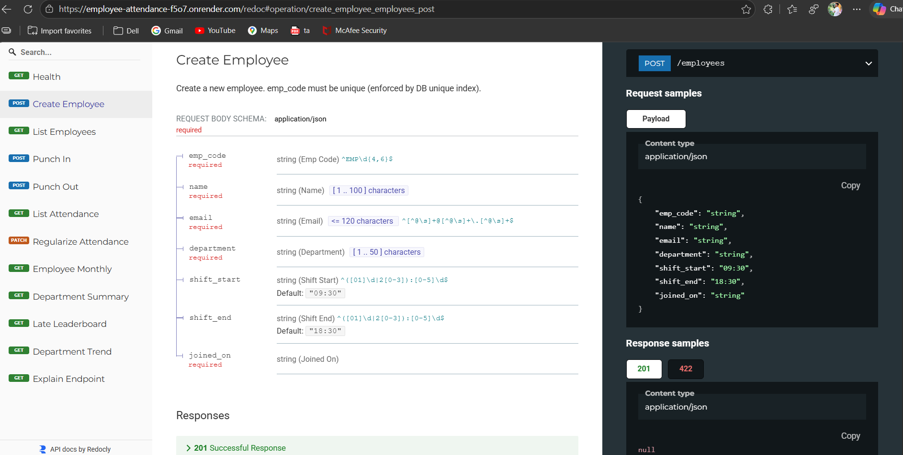

# Employee Attendance & Analytics API

A FastAPI application that records employee punch-in/punch-out events and exposes attendance analytics backed by MongoDB.

## Features

- Create employees and look them up by department.
- Punch in and punch out with automatic computation of late minutes, overtime, work hours, and half-day status.
- Manual attendance corrections (regularization) with a full audit trail stored per record.
- Analytics: per-employee monthly summary, department summary, late-comers leaderboard, and daily attendance trend with 7-day moving average.
- MongoDB index verification via `/admin/explain/{endpoint}`.

## Requirements

- Python 3.11+
- MongoDB 6.0+ (running locally or accessible via a URI)

### Environment variables

| Variable | Default | Description |
|---|---|---|
| `MONGO_URI` | `mongodb://localhost:27017` | MongoDB connection string |
| `MONGO_DB` | `attendance_db` | Database name |

Create a `.env` file in the project root to set these locally (it is loaded automatically):

```
MONGO_URI=mongodb://localhost:27017
MONGO_DB=attendance_db
```

Do **not** commit `.env` to version control.

## Installation

```bash
python -m venv .venv
# Windows
.venv\Scripts\activate
# macOS / Linux
source .venv/bin/activate

pip install -r requirements.txt
```

## Running the application

```bash
uvicorn app.main:app --port 8000
```

Indexes are created automatically at startup (idempotent).

## Live Deployment

- **Live Service & Web UI**: [https://employee-attendance-f5o7.onrender.com](https://employee-attendance-f5o7.onrender.com)
- **Interactive Swagger Documentation**: [https://employee-attendance-f5o7.onrender.com/docs](https://employee-attendance-f5o7.onrender.com/docs)
- **ReDoc Technical Specification**: [https://employee-attendance-f5o7.onrender.com/redoc](https://employee-attendance-f5o7.onrender.com/redoc)

## API Screenshots

### Interactive Swagger UI (`/docs`)
.png)

The Swagger interface provides interactive testing for all employee, attendance, and analytics endpoints. Developers can inspect schemas, provide parameters, and execute live queries directly against MongoDB.

### ReDoc Specification (`/redoc`)


The ReDoc view renders a structured, responsive documentation portal generated from the OpenAPI specification. It outlines model schemas, parameters, error formats, and response codes in a clean multi-column layout.

## API documentation

Once the server is running locally, open:

- **Swagger UI**: http://localhost:8000/docs
- **ReDoc**: http://localhost:8000/redoc

## Loading sample data

If using the starter kit test data:
```bash
python sample_seed.py
```
This loads the sample employees and attendance logs into the configured MongoDB database.

## Testing

There is no dedicated test suite in this repository. The API can be exercised manually via the Swagger UI or with `curl`/`httpie`.

**Health check:**
```bash
curl http://localhost:8000/health
```

**Create an employee:**
```bash
curl -X POST http://localhost:8000/employees \
  -H "Content-Type: application/json" \
  -d '{"emp_code":"EMP0001","name":"Asha Rao","email":"asha@example.com","department":"Engineering","joined_on":"2026-01-05"}'
```

**Punch in:**
```bash
curl -X POST http://localhost:8000/attendance/punch-in \
  -H "Content-Type: application/json" \
  -d '{"emp_code":"EMP0001"}'
```

**Monthly summary:**
```bash
curl "http://localhost:8000/analytics/employees/EMP0001/monthly?month=2026-07"
```

**Explain a query plan:**
```bash
curl "http://localhost:8000/admin/explain/attendance_list?emp_code=EMP0001"
```